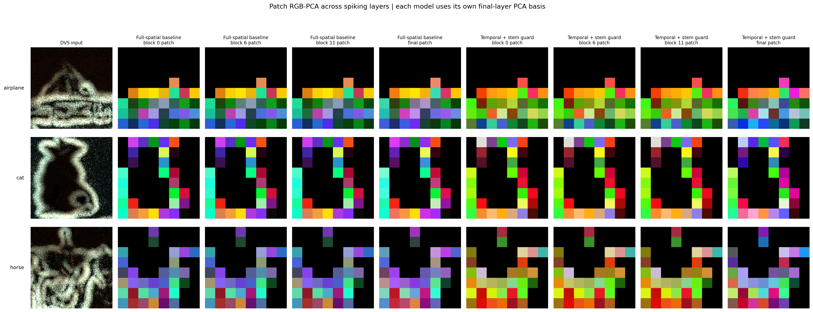
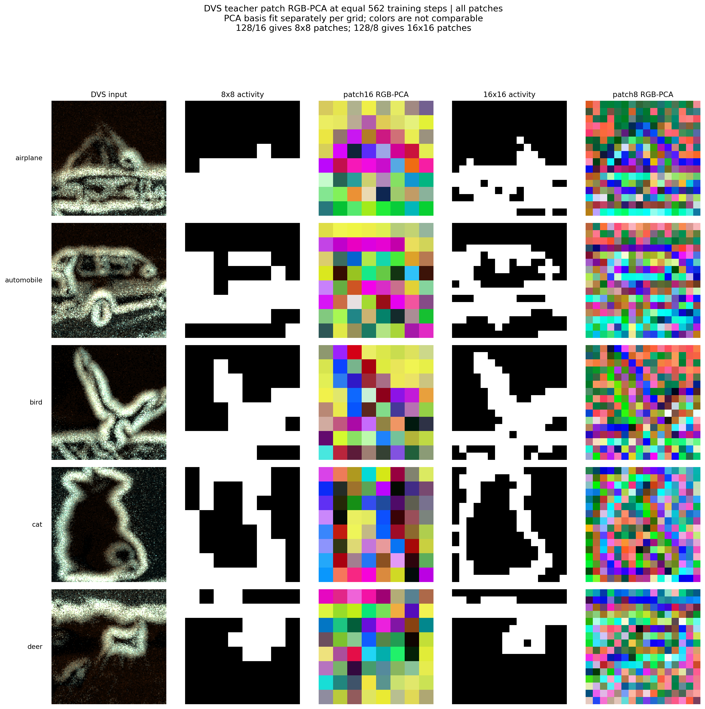

<div align="center">

# Spike-DINO

### Event-native self-distillation with spike-driven evidence transport

[](https://www.python.org/)
[](https://pytorch.org/)
[](https://github.com/fangwei123456/spikingjelly)


**A research implementation of DINO-style teacher–student learning for event-camera data using spiking neural networks.**

[Method](#method) · [Quick start](#quick-start) · [Data](#datasets) · [Evaluation](#evaluation) · [Reproducibility](#reproducibility) · [Roadmap](#roadmap)

</div>

> [!IMPORTANT]
> This repository is an active research preview. It does not yet claim a CVPR-ready result or a full-scale reproduction of DINOv2/DINOv3. Every result below is labeled by protocol and limitation.

## Why Spike-DINO?

DINO learns semantic representations by matching a student to an exponential-moving-average teacher across different views. Directly replacing its backbone with an SNN is insufficient: event observations are temporal and sparse, attention contains multi-bit coincidence information, mask tokens can become false content sources, and small residual scales can prevent useful spike evidence from reaching later layers.

Spike-DINO provides a controlled platform to study these problems with:

| Capability | What is implemented |
|---|---|
| Spiking self-distillation | Student/EMA-teacher training with global DINO and dense iBOT objectives |
| Event-native views | Spatial, temporal, polarity, thinning, masking, and shared-core policies |
| Full-width prototype | 12 blocks, width 384, 6 heads, MLP width 1536 |
| Evidence Spike Block | Visible-event normalized attention, ON/OFF spike projection, bounded membrane writes |
| Fair baselines | SpikeCLR-compatible SEW-ResNet18 path and count-preserving Spikformer operator control |
| Diagnostics | Feature collapse, attention paths, event ablation, dense correspondence, gradients, PCA |
| Reproducibility | Fixed manifests, resumable checkpoints, frozen probes, deterministic cohort seeds |

## Method

The experimental Evidence Spike Block targets the information path rather than a single training hyperparameter.

### 1. Visible-event evidence

Only event bins actually visible to the student supply keys and values. Masked positions remain valid queries, but hidden events, CLS tokens, and mask tokens cannot masquerade as observed content.

### 2. Count-preserving spiking attention

Binary `Q`, `K`, and `V` spikes are accumulated across visible time–token support:

$$
C=\sum_{\tau,j} O_{\tau j}K_{\tau j}V_{\tau j}^{\top},\qquad
z=\sum_{\tau,j} O_{\tau j}K_{\tau j}.
$$

Each query receives normalized evidence

$$
r_{ti}=\frac{Q_{ti}^{\top}C}{\max(Q_{ti}^{\top}z,1)}.
$$

The accumulator preserves multi-bit coincidence counts. It does not apply an intermediate LIF to `KᵀV`. This matters because `Q(KᵀV)=(QKᵀ)V` in exact linear arithmetic; the harmful operation in the earlier prototype was premature thresholding, not the contraction order itself.

### 3. Bipolar spike transport

Query evidence is centered across channels and encoded as two binary streams:

$$
S^+=SN(\mathrm{ReLU}(\mathrm{RMS}(r-\bar r))),\qquad
S^-=SN(\mathrm{ReLU}(-\mathrm{RMS}(r-\bar r))).
$$

A shared projection produces the signed current `W S⁺ − W S⁻`. Learned synapses consume binary spikes while preserving both positive and negative evidence.

### 4. Energy-bounded membrane write

The projected current is written to the real-valued membrane carrier with a depth-aware energy bound. This avoids both near-zero LayerScale writes and uncontrolled residual amplification. The next learned synapse receives a freshly emitted spike train.

The implementation lives in [evidence_block.py](spike_dino/evidence_block.py), with backbone integration in [spiking_vit.py](spike_dino/spiking_vit.py). Detailed assumptions and falsification tests are documented in [the design note](docs/evidence_spike_block.md).

## What is actually spiking?

An SNN backbone does not imply that every intermediate value is binary. This repository states the boundary explicitly:

| Interface | Representation |
|---|---|
| Q/K/V projection inputs and outputs | Binary spikes |
| `KᵀV`, key sums, query normalization | Integer counts / real currents |
| Evidence centering and RMS normalization | Real membrane currents |
| Output projection input | Binary ON/OFF spikes |
| Projection output and residual carrier | Signed real currents |
| FFN learned-matrix inputs | Binary spikes |
| DINO/iBOT probabilities and losses | Continuous training readout |

The accurate description is **spike-driven learned synapses with real-valued membrane and training state**, rather than “every layer-to-layer value is binary.”

## Current evidence

### Mechanism checks

- 113 tests pass, including dense/reference operator equivalence, hidden-event isolation, batch isolation, duplicate-evidence invariance, binary synapse inputs, finite backward passes, and exact checkpoint resume.
- A full-width real CIFAR10-DVS step (`T=4`, batch 16, 12×384/6) completed with finite gradients.
- Frozen-QKV diagnostics show that count-preserving attention retains substantially more cross-view correspondence than the earlier path with an intermediate context LIF.

### Preliminary 281-step diagnostic

The table below uses one seed and an internal labeled holdout from the CIFAR10-DVS training partition. It is **not** a benchmark result, does not access the official test set, and is too short for a paper claim.

| Block / attention path | CLS kNN | CLS linear | Patch kNN | Patch linear | CLS effective rank |
|---|---:|---:|---:|---:|---:|
| Earlier context-LIF baseline | 18.7 | **23.8** | 24.5 | **26.4** | 270.0 |
| Spikformer count-operator control | **19.4** | 22.8 | **25.3** | **26.4** | 270.6 |
| Evidence Spike Block v0 | 14.6 | 16.8 | 19.4 | 21.1 | **351.6** |

The v0 block preserves feature diversity but currently reduces frozen classification accuracy. This rules out the present combination as a finished method. The next experiments must isolate visible support, query normalization, bipolar encoding, and residual writing before longer training.

## Qualitative representation diagnostics

These visualizations use teacher patch features from controlled CIFAR10-DVS runs after 562 optimizer steps. RGB channels are the first three PCA components. PCA is fitted separately for each compared model or grid, so exact colors must not be compared across columns; the meaningful signal is spatial structure and consistency.

### Representation evolution through spiking blocks



The rows show real DVS recordings; columns trace patch features through blocks 0, 6, 11 and the final representation. The figure is a diagnostic of spatial organization, not evidence of semantic segmentation.

### Patch resolution and the visible “mosaic”



At 128×128 input resolution, patch16 creates an 8×8 feature grid while patch8 creates a 16×16 grid. Upsampling either grid cannot recover within-patch detail, which is why the RGB-PCA map looks blocky. Finer maps require smaller patches or a hierarchical decoder, and should be compared at matched compute.

## Quick start

### Installation

Python 3.10 or newer is recommended.

```bash
git clone https://github.com/ziwen518/spike-dino.git
cd spike-dino
python -m venv .venv
source .venv/bin/activate  # Windows: .venv\Scripts\activate
python -m pip install -r requirements.txt
```

The code has been exercised with Python 3.12, PyTorch 2.11, SpikingJelly 0.0.0.0.14, and NumPy 1.26.

### Run the tests

```bash
python -m pytest -q
```

### Synthetic wiring check

This command verifies the training path; synthetic inputs are not evidence of representation quality.

```bash
python -m spike_dino.pretrain_v3 \
  --synthetic --device cpu --output runs/smoke \
  --size 32 --patch-size 8 --local-size 16 \
  --time-steps 2 --batch-size 2 --local-crops 0 \
  --depth 2 --dim 64 --heads 4 --head-hidden 128 \
  --bottleneck 32 --prototypes 128 --steps 1 --no-checkpoint
```

Add `--block-variant evidence` for the proposed block. Use `--attention-variant spikformer_count` with the standard block for the count-preserving operator control.

## Datasets

Raw data is intentionally not included. Download metadata and checksums are stored in `configs/`; deterministic split manifests contain relative paths and labels only.

| Dataset | Event format | Repository support |
|---|---|---|
| CIFAR10-DVS | AEDAT2 | download, manifest, pretrain, frozen probe |
| N-Caltech101 | 5-byte events | manifest, pretrain, few-shot cohorts |
| N-MNIST | binary events | download metadata, manifest, pretrain subset |
| DVS-Gesture | Tonic-compatible events | download metadata, subject-aware manifest |

```bash
python -m scripts.download_cifar10dvs --help
python -m scripts.build_benchmark_manifests --help
python -m scripts.build_fewshot_manifests --help
```

For comparison with SpikeCLR, each dataset should be pretrained and evaluated separately. A multi-domain model must be reported as a different protocol.

## Training

A compact real-event example follows. It is an engineering recipe, not the final recommended schedule.

```bash
python -m spike_dino.pretrain_v3 \
  --dataset-root dataset/CIFAR10DVS \
  --manifest-path configs/splits/cifar10dvs_seed42.json \
  --output runs/cifar10dvs_evidence --device cuda:0 \
  --size 128 --patch-size 16 --local-size 64 \
  --global-view-policy shared_core --global-crop-scale 0.32 1.0 \
  --global-time-range 0.5 1.0 --time-steps 4 --batch-size 16 \
  --local-crops 0 --depth 12 --dim 384 --heads 6 \
  --block-variant evidence --norm-policy layer_norm \
  --head-hidden 2048 --head-layers 3 --bottleneck 256 \
  --prototypes 65536 --prototype-readout cosine \
  --target-policy sinkhorn --mask-policy fixed_block \
  --steps 562 --checkpoint-every 50
```

Outputs are written only to the requested run directory. Resume validation checks architecture and schedule fields before restoring optimizer, student, teacher, and center state.

## Evaluation

Frozen CLS representations:

```bash
python -m spike_dino.evaluate_v3 \
  --dataset-root dataset/CIFAR10DVS \
  --checkpoint runs/cifar10dvs_evidence/last.pt \
  --output runs/cifar10dvs_evidence/frozen_cls.json \
  --device cuda:0 --feature-source cls \
  --cohort-seed 42 --probe-seed 42
```

Use `--feature-source patch_mean` for dense patch representations. Scripts for layer-wise PCA, RGB-PCA maps, attention-path auditing, event ablation, gradient diagnostics, and geometric correspondence live under `scripts/`.

## Reproducibility

Before comparing two methods, keep these fields identical:

- dataset manifest and hash;
- pretraining seed, number of optimizer steps, and batch size;
- global/local view and temporal support policies;
- masking policy and teacher patch aggregation;
- head depth, bottleneck width, prototype count, and readout;
- optimizer, EMA, temperature, and weight-decay schedules;
- frozen-probe cohort seed and probe initialization seed.

The official test split should remain untouched during method development. Internal holdout metrics must be labeled as such.

## Repository structure

```text
spike_dino/
├── spike_dino/                 # models, objectives, data, training, evaluation
│   ├── evidence_block.py       # proposed evidence transport block
│   ├── spiking_vit.py          # spiking ViT backbone and attention controls
│   ├── dinov3.py               # student/teacher prototype and heads
│   ├── pretrain_v3.py          # resumable self-supervised trainer
│   └── evaluate_v3.py          # fixed-cohort frozen evaluation
├── scripts/                    # preparation, diagnostics, PCA, and audits
├── configs/                    # checksums and deterministic manifests
├── tests/                      # unit and end-to-end resume tests
├── third_party/eventclr/       # minimal SpikeCLR-compatible baseline snapshot
└── docs/                       # architecture and research design notes
```

## Roadmap

- [x] Full-width spiking teacher/student training path
- [x] DINO global and iBOT dense objectives
- [x] Fixed manifests for four SpikeCLR event datasets
- [x] Count-preserving Spikformer operator control
- [x] Evidence Spike Block v0 and falsification tests
- [ ] Component-wise ablation of evidence transport
- [ ] Stable improvement across at least two random seeds
- [ ] Full SpikeCLR-matched LP/FT/few-shot protocols
- [ ] Multi-dataset main table and transfer evaluation
- [ ] ANN/SNN compute, memory, spike-rate, and energy accounting
- [ ] DINO-style dense RGB-PCA and correspondence figures for final models

## Citation

This project does not yet have an archival paper. Please cite the repository commit when using the current research preview. A BibTeX entry will be added with the paper release.

## Third-party code and licensing

`third_party/eventclr/` contains the minimal EventCLR-derived components used by the SpikeCLR-compatible baseline. Provenance and license are recorded in [NOTICE.md](third_party/eventclr/NOTICE.md) and [LICENSE](third_party/eventclr/LICENSE).

No license is granted for the remaining repository code unless the repository owner adds one explicitly.

---

<div align="center">
Built for transparent, falsifiable research on event-based self-supervised learning.
</div>
