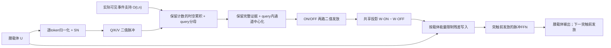

# 面向事件自蒸馏的脉冲块设计

日期：2026-10-20。状态：**设计与最小可运行原型，尚未证明精度有效，也未建立CVPR级创新性**。本文件只定义一个可证伪的主方案；不把此前失效的开关全部堆叠。

## 1. 核心判断及必须纠正的基线

当前证据：Q/K/V各自仍能区分录制，但聚合、再发放和投影后差异减小；mask/位置token会供应大量伪内容；微小LayerScale使分支改动写不进主干；简单放大和反向处理又不能稳定CLS。与此同时，局部任务预测具体事件更准并不等于类别表征更好。公开仓库只保留本设计与可复现实验代码，完整内部实验日志不随首版上传。

**数学纠正：**没有中间非线性时，`Q(KᵀV)=(QKᵀ)V`，关联律换序本身不损失线性注意力信息。此前“先形成KᵀV就必然丢掉query特异性”的表述不严谨。真正的差别是本项目用了`SN(KᵀV/N)`，再与Q相乘；这会将多次共发放的计数提前压成0/1。

[Spikformer官方SSA](https://github.com/ZK-Zhou/spikformer/blob/main/imagenet/model.py)在完整QKV计数聚合后才缩放并发放，没有这个中间context LIF。现有`matrix_legacy`也仍有context LIF，因此不能当作忠实的Spikformer聚合基线。本轮新增两项明确控制：`matrix_count`只移除中间LIF、保留原`1/N`缩放；`spikformer_count`采用官方聚合算子的`.125`缩放与`.5`输出门槛。它们仍使用本项目stem/归一化，**只复核注意力算子，非复现整套Spikformer**。

## 2. 文献给出的边界

| 官方来源 | 实际可借鉴的处理 | 对本项目的约束 |
|---|---|---|
| [Spikformer源码](https://github.com/ZK-Zhou/spikformer/blob/main/imagenet/model.py) | 二值Q/K/V，保留QKV聚合计数后再发放；卷积脉冲stem | 先验证移除多余context量化，不能把任意再量化规则称为SSA原式 |
| [Spike-driven Transformer源码](https://github.com/BICLab/Spike-Driven-Transformer/blob/main/module/ms_conv.py) | 突触前发放；投影末端电流与identity相加 | “全脉冲”应逐突触界定；残差膜电流不必处处0/1。本项目的直接有符号电流替换曾溢出，不能忽略写入尺度 |
| [QKFormer源码](https://github.com/zhouchenlin2096/QKFormer/blob/master/imagenet/qkformer.py)与[作者修正说明](https://github.com/zhouchenlin2096/QKFormer#notice-implementation-issue-in-ssa) | QK门控、层级stem；作者修正了先reshape回T/B再应用多步LIF的顺序 | 门控并非ViT softmax同义替换；必须保持时间/样本维度，检查跨样本泄漏 |
| [STAtten官方代码](https://github.com/Intelligent-Computing-Lab-Panda/STAtten/blob/main/module/ms_conv.py) | 在时间chunk与空间token共同组成的集合内聚合，然后发放 | 跨时间注意力已有先例，不能单独作为本项目创新；mask必须精确到时间片 |
| [Linear Transformer原论文](https://proceedings.mlr.press/v119/katharopoulos20a.html) | 正核注意力的分母归一化与关联式累积 | `QΣKV / QΣK`不是新发明；创新若成立，应来自事件观测边界、脉冲编码和自蒸馏信息保真的具体机制与证据 |

## 3. 主方案：可见证据归一化、正负脉冲写入

暂不使用论文式名称。第一版输入仍为`U∈R[T,B,N,C]`膜载体，输出形状相同，可替换一个ViT-S块。主体是一个注意力路径与一个FFN路径，保留Q/K/V、输出投影和两层FFN的矩阵宽度。

### 3.1 可见支持：遮挡位置是query，隐藏事件不是K/V

令`O[t,b,n]∈{0,1}`仅由**学生真正观察到的输入**构造。隐藏时间片置0；有未遮挡时间片的同一patch继续提供K/V；CLS等特殊token可做query，但不能冒充原始事件证据。可见且完全无事件的输入patch也可置0，避免位置电流作为内容源。

必须先应用学生的时间/空间掩码，再判断事件支持；不能用被遮挡原始事件数量决定gate。当前已接入事件tokenizer：逐时间片patch事件支持与学生可见掩码相交，特殊CLS支持为0。集成测试已证明修改隐藏事件值不改变输出；算子测试还检验了隐藏K/V含NaN/Inf时不泄漏。未遮挡输入中的非有限值不属于允许数据。

### 3.2 保留计数，按query获得的证据质量归一化

Q/K/V由学习型投影、逐token归一化及SN产生，均为二值。对每个录制和head，跨可见时间/位置累积：

\[
C=\sum_{\tau,j}O_{\tau j}K_{\tau j}V_{\tau j}^{\top},\qquad
z=\sum_{\tau,j}O_{\tau j}K_{\tau j}.
\]

\[
r_{ti}=\frac{Q_{ti}^{\top}C}{\max(Q_{ti}^{\top}z,1)}.
\]

`C`和`z`保留多比特共发放计数，不在这里做LIF。分母是**当前query实际收到的符合计数**，不是所有样本统一的`N`常数，也不把每次偶然符合都变成OR式全激活。`r`各通道在`[0,1]`内。整个可见K/V集合重复相同次数时，分子分母同比例变化，`r`精确不变；随机删事件只能期待近似稳定，**不保证严格不变**，需真实事件检验。

这保留了显式逐query归一化注意力的结果，但用关联式累积避免构造完整`TN×TN`矩阵。跨时间是离线事件录制的集合聚合；若将来用于流式任务，需另加因果边界。

### 3.3 保留完整证据，用正负两路编码通道结构

主原型采用`χ[t,i]=r[t,i]−mean_c(r[t,i])`：保留query选择的完整证据，只在该query的通道内去共同偏置，然后分别保留正负方向。

\[
S^+=SN(\mathrm{ReLU}(RMS(\chi))),\quad
S^-=SN(\mathrm{ReLU}(-RMS(\chi))).
\]

ON/OFF各自仍是0/1；有符号编码由两路二值流表示。RMS内归一化会放大小差异，可能把噪声放大，这是一项**待检验风险**，必须与无中心化、无RMS、单正流对照。

**已做的设计反馈：**第一版曾用可见V参考`b=ΣOV/max(ΣO,1)`，仅保留`δ=(r−b)·1[Qᵀz>0]`。真实冻结Q/K/V上，完整归一化证据保持约31.8/32的CLS视图检索，减去整个参考后约19.2/32，说明共同部分也含稳定信息；因此该分支降为`encoding=reference_contrast`消融。通道中心化主编码经ON/OFF与同一旧投影矩阵后，12块平均CLS/patch视图检索约26.7/32、31.8/32，旧注意力输出约2.3/32、8.9/32。单块膜写入仍保留32/32配对；这些是各旧块的**独立局部算子诊断**，没有把新块串联训练，也没有下游精度收益。

### 3.4 二值突触输入与可写入膜载体

输出电流为`I=RMS(Wo S+ − Wo S−)`，两路使用同一投影矩阵。学习型突触分别处理二值脉冲；投影后保留有符号电流，下一突触前重新SN。

为避免`1e-5`级LayerScale写不进去，也避免统一放大累积拥挤，先用无新学习参数的深度/能量规则：

\[
U'=U+\frac{\min(1,RMS(U)/\max(RMS(I),\epsilon))}{\sqrt{2L}}I.
\]

比例在反向中detach，保留载体显式identity梯度。每次分支更新RMS不超过原载体RMS除以`√(2L)`；**这不证明深层Jacobian有界或精度稳定**，我们的旧反向限幅结果已说明必须验证整轮轨迹。没有query证据时注意力写入严格为0。FFN保留脉冲突触前编码、第二层输出电流，并用相同残差规则；不同时加入新的梯度投影或新损失。

## 4. 哪些地方是脉冲，哪些不是

| 接口 | 表示 |
|---|---|
| Q/K/V投影输入与输出 | 二值脉冲 |
| `C,z,QᵀC,Qᵀz` | 计数/电流，非二值；没有新学习矩阵 |
| 归一化证据、通道中心化电流、RMS | 实值膜电流 |
| 输出投影输入 | ON/OFF两路二值脉冲 |
| 输出投影及残差载体 | 有符号实值电流；下一突触前发放 |
| FFN两层学习矩阵的输入 | 二值脉冲 |
| DINO/iBOT概率、loss、最终读出 | 连续训练读出 |

因此研究目标可表述为“学习型突触以脉冲驱动的事件DINO”，不能表述“所有层间通信均为0/1”。能效需计算两路ON/OFF活动、累积/除法/归一化及内存成本，不能只数乘加省略控制代价。

## 5. 模块尺度与当前代码

原型：[evidence_block.py](../spike_dino/evidence_block.py)。`dim384/heads6/FFN1536`下六个学习矩阵分别为四个`384×384`和`1536×384`、`384×1536`，与当前ViT-S块的矩阵大小一致；原型每块1,776,384参数，当前LayerScale块1,777,152，差768来自归一化/尺度参数，尚非严格逐参数匹配。ON/OFF增加神经元状态和计算，但共享投影权重。

原型已通过事件tokenizer的可见支持契约及12层teacher/student集成验证：本地113项测试通过；真实CIFAR10-DVS、T4、batch16、128/patch16、12层384维6头的一步GPU反向有限，峰值分配8471.1MiB。日志见`server/v3_evidence_block_smoke_metrics.jsonl`。单步成功不代表训练收敛或精度提高。它不是DINOv3的RoPE、storage token或7B预训练等效物；这里先验证SNN块的机制，不能把384维原型称为官方7B尺度。

## 6. 验证顺序与淘汰标准

1. **算子基线**：原`matrix_recode`、去context量化的`matrix_count`、Spikformer聚合算子参考；固定已训练QKV与投影，定位计数保留的真实作用。
2. **核心证据电流**：验证稠密逐query式与关联式数值相同、重复证据不变、隐藏时间片不泄漏、样本状态互不混合、无证据精确零输出。已通过五项本地机制测试。
3. **组件消融**：分别测试逐query分母、时间聚合、可见支持、正负编码和能量写入；先单项，再组合，不借额外teacher或改loss掩盖故障。
4. **真实事件梯度与通路**：完整宽度首步有限，学习突触输入二值；masked输出确实响应可见事件；同位置正确录制优势为正，清零事件后显著减弱；两路view一致性不能像WTA一样垮掉。
5. **训练收益**：同数据清单、参数矩阵尺度、优化步与probe队列，第一轮CLS/patch冻结共同改善且有效秩不后期坍缩，再测第二种子与三轮/六轮。保留PCA与传感器坐标对应评估，避免只优化分类一个数。
6. **发表证据**：至少两个种子和多个事件数据集、匹配预算的ANN/现有SNN注意力/SpikeCLR基线、分组件消融与效率账。归一化线性注意力、时间聚合和膜残差各自均有先例，需文献核查后才能界定组合是否构成足够方法创新。

当前结论：设计有明确的故障对应和可测试性质，**没有训练精度突破证据**。后续结果必须连同配置、随机种子和评估协议一同发布。

### 当前有限预算对照

用`scripts/run_evidence_block_comparison.py`在物理GPU0顺序比较：旧额外context LIF的既有281步检查点、从头281步的Spikformer计数算子参考、从头281步的完整新块。固定CIFAR10-DVS训练清单、seed42、T4、128/patch16、12/384/6、两global无local、投影头、损失、学习率和EMA；仅架构变化。新块矩阵尺寸相同，但规范化/尺度参数和ON/OFF计算量并非严格相同，需分别记账。每个检查点用固定512训练/1000内部验证队列评估CLS与patch平均；不访问官方测试。281步用于初筛，尚不足证明长期收益。训练/评估为独立顺序子进程，结束即释放各自GPU上下文，失败则停止后续阶段并记录状态。
